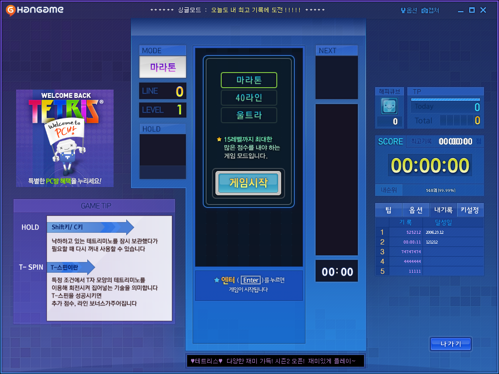

# Single Mode findings (2026-11-15)

This note records the current, evidence-backed state of the original client's
`싱글모드` (orange button) path. It supersedes the earlier direct-entry/room-list
investigation: `바로입장` is an online-room selector and is not the target.

## Click target

The client window is a 1024x768 X11 window at X-origin `(0,0)` even when the
compositor draws it elsewhere. XTEST clicks must use window coordinates, not
desktop screenshots. The orange `싱글모드` button is at approximately
`(459,195)` in that coordinate space. The previous "My Items" click was a
coordinate miss, not an experiment.

## Client path

`FUN_0049D0A0` is the orange-button handler. It:

1. checks the game/room state at `+0x108c`;
2. calls `FUN_004FE660(0,1)` -> `FUN_004FC280(2)`, which constructs
   `CTetSingleScene` (`FUN_00462CB0`) and its `CTetSingleMainBody`;
3. sends `Cmd_Room_OrderTypeAutoEnterSingleModeRoomTetrisToS`
   (`0x031AC76A`) on the channel.

The server replies with `AutoEnterSingleModeToC` (`0x0DF37B3A`), then the
client sends `Cmd_Channel_CreateRoomToS` (`0x0CA9895A`), connects to the game
socket, sends `Cmd_Room_EnterRoomToS` (`0x09A5347A`), and processes
`Cmd_Room_EnterRoomToC` (`0x0974DCEA`).

## Immediate blocker

`CTetSingleScene::Update` (`FUN_00462600`) runs before
`CTetSingleMainBody::Start` (`FUN_00460DD0`). The main-body vectors at `+0x268`
are zero-filled by the constructor, so the update faults at `0x461E9D`
(`mov edx,[ebp+0x2c]`, EBP=0) and, if the first call is skipped, inside
`FUN_00461FA0` at `0x462009`.

`Start` is only reached through the scene's start control:

- `0x463780` (Enter/start-control check) -> `0x45C1A0` -> `0x460DD0`
- `0x463880` (mouse/start button) -> `0x45C1A0` -> `0x460DD0`

Neither fires before the first update. Holding the start button and pressing
Enter before the click did not change this.

## Debug proof

A debug-only copy of `Tet4.exe` with both update calls NOPed
(`0x4627F0` and `0x4627F7`) no longer crashes. The real Single Mode UI renders:
Marathon/40-lines/Ultra mode selection, HOLD/NEXT panels, score and the
`게임시작` button with the text "엔터(Enter)를 누르면 게임이 시작됩니다"
("Press Enter to start the game").

This proves the protocol and encryption up to `EnterRoomToC` are sufficient to
create the scene. The remaining problem is the client's premature update, not
the room-list filter.

Clicking `게임시작` after the game socket has already closed terminates the
client. The game socket currently closes shortly after `EnterRoomToC`; the
client's timeout dialog `제한 시간에 걸렸습니다` follows. The server still needs
the correct game-socket lifecycle/start payload.

## Environment

- Native `msvcr90`/`mfc90` (app-local VC90 DLLs) is required. Forcing builtin
  `msvcr90`/`msvcp90`/`mfc90` with `WINEDLLOVERRIDES` prevents the client from
  starting at all.
- Native overrides do not remove the `0x461E9D` crash. This is not a DLL
  override issue.
- The Wine prefix has `vcrun2008`, `dotnet40/48`, `dxvk`, fonts and Korean
  locale; the client needs `LANG=ko_KR.UTF-8`.

## h-tetra / remote repository

The `h-tetra.exe` launcher is a .NET TCP tunnel and contains no game logic. The
fan server was a separate Python bundle (`server/tools/run_local_server.py`)
that was never shipped with the client and is not in the public archives.
There is no public copy in the local downloads or GitHub branches.

`origin/main` currently has only the docs commit
`a6f99a6 Docs: fix local Single Mode launch workflow`. PR #19 is a docs-only
draft and does not contain a Single Mode implementation.

## Game-model bootstrap: the missing message is AddMemberToC

The main-body vector at `+0x268` is not filled by `Start` alone. The client
already calls `CTetSingleMainBody::FUN_004625A0` (vtable slot 7) before the
crash. That function calls `FUN_00461C50`, which walks `+0x268` and fills each
entry with `FUN_004EB0C0(index)`. `FUN_004EB0C0` is a lookup in the game
model's player map at `+0x128/+0x140`; when no player has been registered it
returns `0`, leaving the vector entries null.

The game model is populated by the **server-to-client**
`Cmd_Channel_AddMemberToC` (`0xAB84D0A`):

- Tet4.exe registers it as `PC_RegisterX2M(0xAB84D0A, 3, FUN_00456BC0, ...)`.
- `FUN_00456BC0` -> `FUN_00432280` -> `FUN_004EC400` adds the member to the
  game model when the member id is the local member.
- `FUN_004EC400`/`FUN_004EC750` update the player map used by
  `FUN_004EB0C0`; `FUN_004EC750` also calls `FUN_00461C50` when the active
  visual state is `'Z'`.
- The client converter reads keys `k3e`, `k23e`, `k24e`, `k7e`, `k8e`, `k11e`,
  `k10e`, `k12e`, `k26e`..`k35e`, `k37e`, `k38e`, `k102e`, `k151e`, `k201e`
  and the `k153e<i>` vector.

The current local server never sends `Cmd_Channel_AddMemberToC` on the game
connection. That is why the vector is null even though the scene and main body
exist. The fan server necessarily supplied this game-model bootstrap (or an
equivalent message path) before the scene update.

## Start-message registration facts

- `Cmd_Room_StartNewGameSvcKorToC` has class id `0x13AA2DA`, but HgCom3
  registers its converter `FUN_60147870` under wire id `0xF809B5A`.
- Tet4.exe also has `PC_RegisterX2M(0xF809B5A, 3, FUN_00459BD0, ...)`, whose
  converter constructs `Cmd_Room_OrderTypeStartNewGameTetrisToC`
  (`0x06FE5D0A`) and reads `_AliasInfo` entries.
- Live tracing showed the SvcKor converter path is the one reached by the
  current game flow: it produces `k3e<i>`, `k118e<i>`, `k119e<i>` and reaches
  `CF5GameWnd::Evt_OnStartNewGame` (`0x60A090D0`). That handler only updates
  `CPlayerInfo+0x118/+0x11C`; it does not fill the main-body vector.
- Sending `0xF809B5A` with an `_AliasInfo` vector did not reach
  `FUN_00459BD0` in the live test. The direct `0x06FE5D0A` container is not
  registered.
- `Cmd_Room_OrderTypeSingleModeGameReportTetrisToC` (`0x0EE1D56A`) is a
  different message: its converter `FUN_00450940` calls `FUN_00461E70` after
  processing a report and is a gameplay update, not the initial bootstrap.

## Game TCP close

`tet4server/game.py` does not close the connection after `EnterRoomToC`; it
continues in `read_frame`. The observed close is client-initiated. With
`winedbg` paused, the close can be deferred by several seconds, so it is not a
simple fixed server-side timeout. The exact client call site (`CF5GameWnd::
Net_SocketClose`, `ExitGameRoom`, or the `CHgtpSocket` close path) has not yet
been isolated. The timeout dialog `제한 시간에 걸렸습니다` appears after the
socket is gone; it must not be treated as the original cause.

## Open evidence gaps

1. Which exact `Cmd_Channel_AddMemberToC` field values (member id, room id,
   team/seat, level, avatar/rank) the game model needs for the local player,
   and whether the fan server sent it on the channel or game connection.
2. Whether `Cmd_Channel_AddMemberToC` alone is sufficient to make
   `FUN_004EB0C0` return a non-null player before the first update, or whether
   another member/room message is also required.
3. The exact client call chain that closes the game socket.
4. The `_SingleModeInfo` field mapping and the `GameReportToC` payload, needed
   only after the initial bootstrap and first local game report.
5. The board/piece constants and scoring rules expected by the client's local
   game loop; these are not yet recovered.

## AddMemberToC server-side probe — current accepted candidate

The original tagged/type-ID candidate described in the earlier experiment was
superseded by the 2026-11-15 isolated live runs and the serializer update in
PR #22.

The currently accepted layer-3 body is:

    0x0AB84D0A | XDR string(member_id) | 87-byte opaque suffix

Do not prepend 0x005216CA or 0x0FFA613A: the old candidate caused the client
to treat those words as the first string length. The 87-byte suffix is still
opaque, and the live test used member ID test.

The corrected packet is sent only on game port 15002, behind
TET4_EXPERIMENTAL_ADD_MEMBER_BOOTSTRAP=1. The default server behavior remains
unchanged. A/B/C isolation confirms the corrected message reaches
FUN_00456BC0 -> FUN_00432280 -> FUN_004EC400, inserts the local member and
triggers another FUN_00461C50 refill. It does not yet make the client start
the game or display the board.

TET4_SKIP_SVCKOR=1 reproduces AddMember-only; TET4_SVCKOR_BEFORE_ADD_MEMBER=1
reverses the two messages. Neither order fixes the post-refill dispatch failure.
docs/ROADMAP.md and the current tet4server/single_mode.py contain the
maintained implementation details.

## 2026-11-15 — A/B/C isolation: dispatch registration, not packet order

The three runs on commit acb6a86 separate the failures:

- A, corrected AddMember only: FUN_004EC400 and the second FUN_00461C50
  are reached; a later 0x004FBBB4 dereference faults with EAX=0.
- B, AddMember then SvcKor: this run loses the race to the independent
  0x00461E9D scene-update fault before AddMember is dispatched. It is not
  evidence about the AddMember handler.
- C, SvcKor then corrected AddMember: the member is inserted and the vector
  refilled, then the same 0x004FBBB4 null dereference occurs.
- None reaches CTetSingleMainBody::Start (0x00460DD0).

The A and C traces therefore rule out message order as the fix. The failure is
after the AddMember converter and the vector refill.

### What the 0x004FBBB4 stack says

The null-fault register snapshot has EAX=0, ECX=0x005F29F0,
EDX=0x6011D5E0; the return address on the stack is HgCtr3.dll:0x602091B5.

FUN_004FBB90 reads the IParam service and command through virtual slots 2 and 3.
For CMetpParser, the service getter is the 0x60105380 implementation (also
aliased in the decompilation as CFrameworkException::GetErrorCode); it returns
the parser's offset_0x24. CMetpParser::GetCommand at 0x6011D5E0 returns
offset_0x28. The fault at 0x004FBBB4 is the subsequent dereference of the
service pointer, so the evidence says that GetService() returned null for
this parser. It is not evidence that the AddMember member-id string is null.

### The missing dispatcher registration candidate (superseded)

**Correction (2026-11-15):** this hypothesis is wrong. `0x602091AF` is the
registered `CFunctor::Call`; `0x602091B5` is its return address. The true
`God()->Call` fallback starts at `0x602091BA`. The dispatcher is registered
and is called. See the late-run section at the end of this file.

CNetworkController::OnSocketReceive (HgCtr3.dll:0x60208ED0) has two paths
for the Tetris game service:

1. It asks GInfo()->GameEvent()->FntDispatchService() for a CFunctor.
   If CFunctor::Get() returns a non-null callback, it invokes
   CFunctor::Call(parser).
2. If the functor is empty, it falls back to God()->Call(...). The call
   instruction at 0x602091B0 returns at 0x602091B5.

The AddMember null-fault stack contains return address 0x602091B5. That is
the return address of the registered dispatcher call at 0x602091AF, not the
fallback. FntDispatchService was bound at that moment.

The explicit binding site found in Tet4.exe is FUN_004FF390, the
CTetGameWnd constructor. It creates a CMFunctor<CTetGameWnd> for
LAB_004FD9E0 and assigns it to CGlobalGameEvent::FntDispatchService() through
CFunctor::operator=(IFunctor*) at HgCom3.dll:0x6010C8F0. The same
constructor registers the separate onAddRmMember and onDelRmMember events
with God(). FntDispatchService() returns the embedded functor at
CGlobalGameEvent + 0x18 (accessor alias 0x60112AA0); the
CGlobalGameEvent constructor initially leaves that functor empty.

This hypothesis was disproved by the late run: the constructor and the
registration both happen, and the dispatcher is called. The null service is
inside `FUN_004FBB90`, reached through the registered target.

Use tools/debug/break-game-event-dispatch.wdbg to establish whether
FUN_004FF390 and the CFunctor assignment occur before the game packet,
whether CFunctor::Call is reached, and what CMetpParser::GetService
returns at the failing dispatch.

## 2026-11-15 — early AddMember ordering and dispatcher identity

The server now supports a diagnostic early-send ordering:

    TET4_EARLY_ADD_MEMBER_ID=test TET4_SKIP_SVCKOR=1 python3 -m tet4server

The AddMemberToC body is sent after EnterRoomToS is parsed and **before**
EnterRoomToC. The configured ID must equal the local member in
EnterRoomToS; a mismatch is refused and the normal post-EnterRoom send is
suppressed. The default server behavior is unchanged when the variable is
absent. Tests cover the matching, mismatch, default and duplicate-suppression
cases.

The live run with the original layer-3 87-byte body reached, in order:

    0x00456BC0  AddMemberToC converter
    0x004EC400  game-model insert
    0x00461C50  vector refill
    0x602091AF  registered game dispatcher CFunctor::Call
    0x004FBBB4  FUN_004FBB90 service dereference

The registered dispatcher target was non-null (`0x01DBFAE0` in that run), the
controller name was `"game"`, and the parser service/command fields were both
zero. This is a deterministic AddMember-specific failure, not the scene race.

### Correction: 0x602091AF is not the fallback

`0x602091AF` is the `CFunctor::Call` of the registered game dispatcher. The
return address `0x602091B5` is its return site. The true `God()->Call`
fallback begins at `0x602091BA`. The earlier "unbound dispatcher" conclusion
is therefore retracted: registration happens and the dispatcher is called.

The null is because the layer-3 converter does not set the parser header.
Setting the missing header in GDB memory to `"s1e"`/`"c5e"` bypassed the
`0x004FBBB4` fault and reached
`CGameLobbyModel::Msg_AddRoomMember` (`HgModel3.dll:0x60915600`). The next
failure was a fast-fail (`0xC0000409`) at `0x60915756` because key `k57e` was
missing. This proves the header is necessary, but not sufficient: the room
member profile keys are also required.

### Two AddMember message classes

The client has two distinct layer-0 converters:

- `Cmd_Channel_AddMemberToC` `0x0AB84D0A` -> `HgCom3.dll:0x60139BC0`,
  header `s1e`/`c5e`.
- `Cmd_Room_AddMemberToC` `0x0619233A` -> `HgCom3.dll:0x6013A060`,
  header `s4e`/`c5e`, keys including `k50e`, `k57e`, `k58e`, `k3e`.

Tet4.exe separately registers the same `0x0AB84D0A` id at **layer 3** to
`FUN_00456BC0`. That converter inserts the local member into the game model,
but it does not call `CMetpParser::ApplyHeader` and does not expose the room
keys. The accepted 87-byte body is therefore a Tetris layer-3 extension, not
the complete room-member message.

A diagnostic two-layer batch is available with
`TET4_EARLY_ADD_MEMBER_BASE=1`. It sends a layer-0 room base followed by two
alignment markers and the layer-3 extension. The layer-0 room converter is
reached and dispatches with a valid `s4e`/`c5e` header, but the layer-3
converter is **not** invoked in the same frame yet. The pair is therefore
unverified and must not be treated as a working bootstrap. Sending SvcKor
after the room base reaches its converter (`HgCom3.dll:0x60147870`) and the
dispatcher, but still does not call `CTetSingleMainBody::Start` (`0x00460DD0`).

### Next

1. Determine whether `PC_ConvertX2M` accepts more than one populated layer in
   one XLBP frame, or whether the room base and Tetris extension must use a
   different framing/order.
2. Recover the remaining room-member keys and the full profile semantics;
   `k57e` is confirmed mandatory, and the empty-string defaults are only a
   diagnostic placeholder.
3. Re-run `tools/debug/game-event-dispatch.gdb` and confirm whether the
   layer-3 converter can be reached after a valid room base without losing the
   header.
